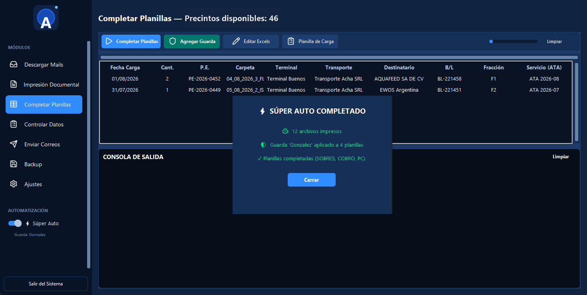
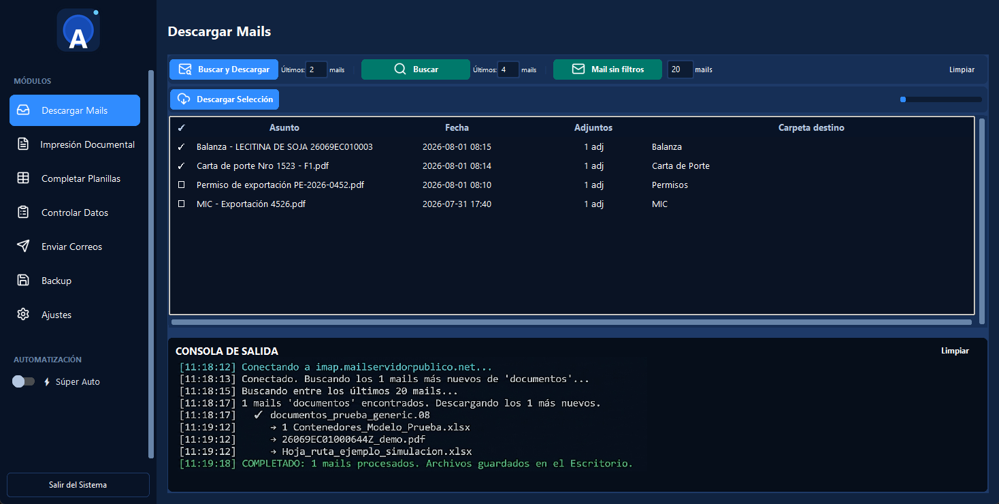
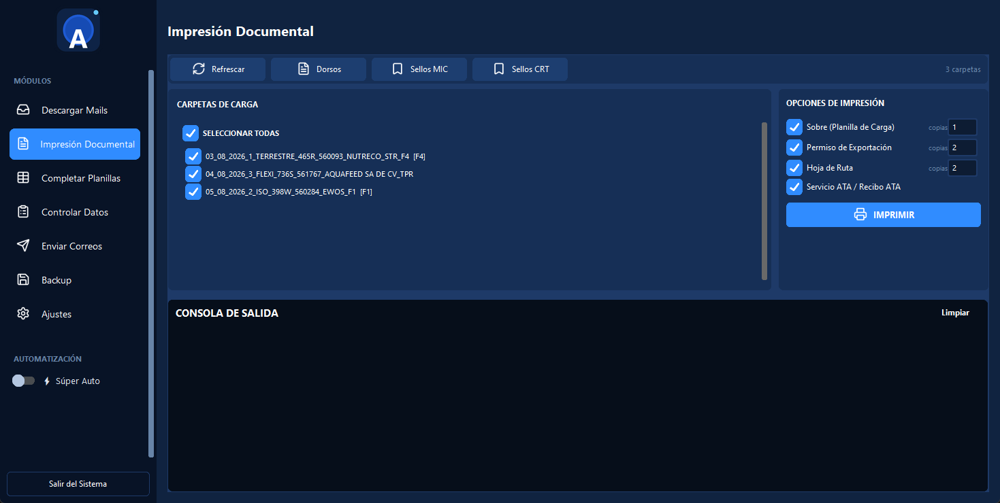
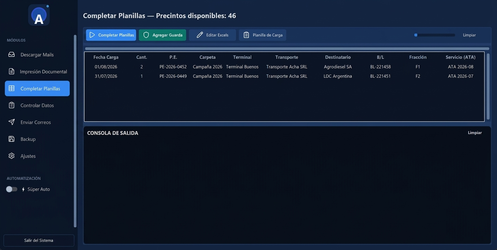
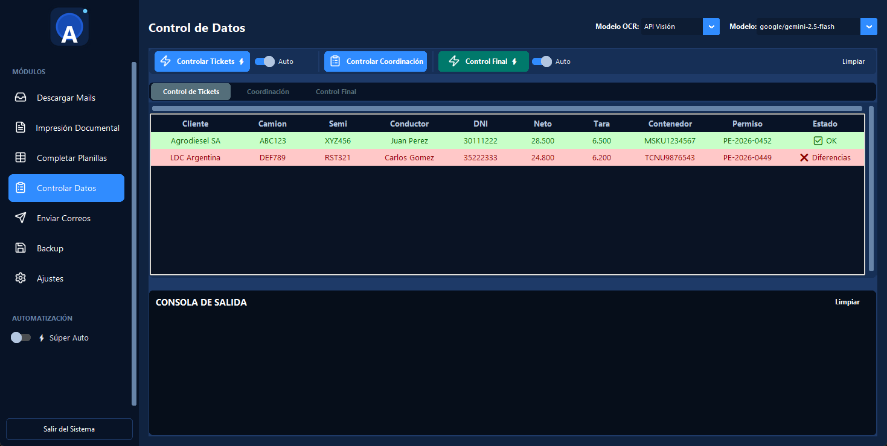
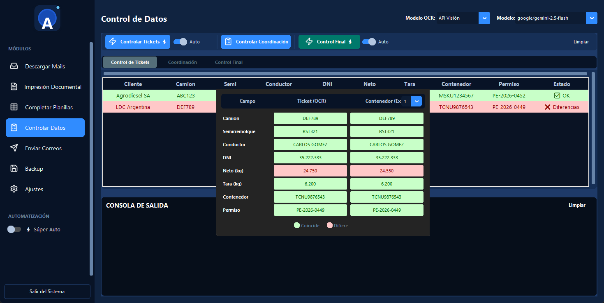
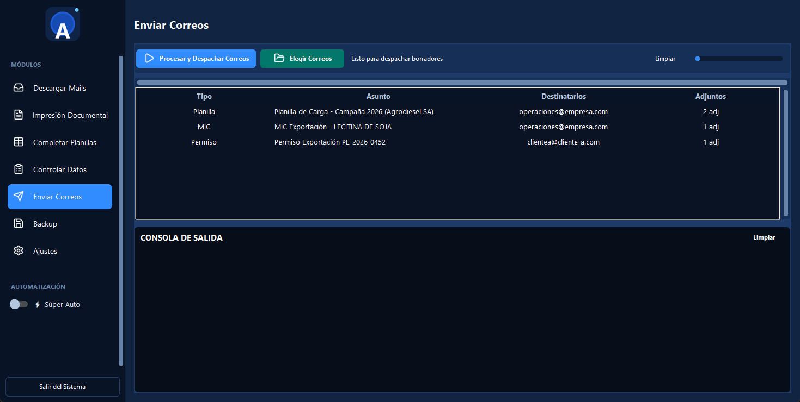
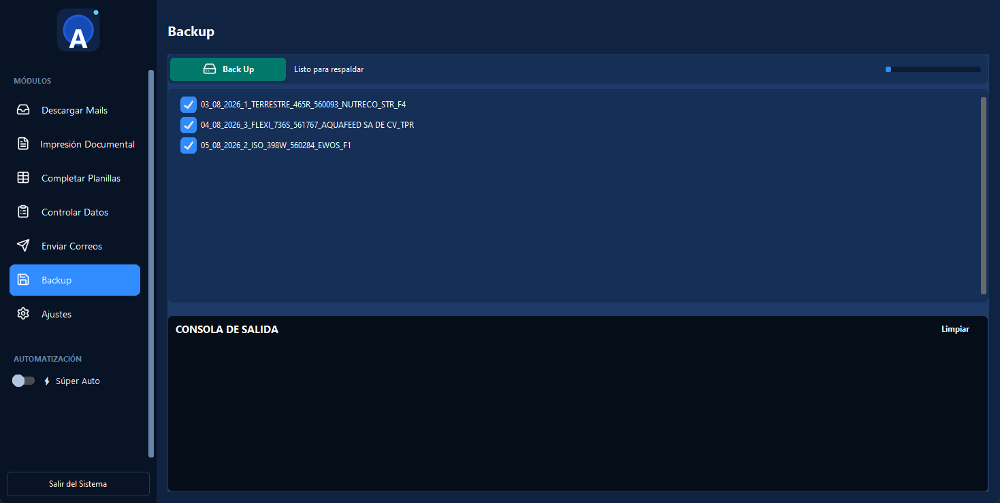
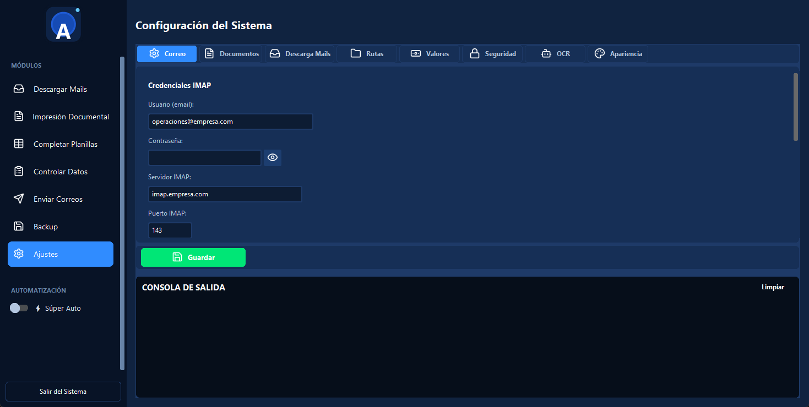

# 🚀 Multiagente — Automatización de Operaciones Portuarias

> Sistema inteligente de escritorio para automatizar operaciones logísticas portuarias: descarga documental, OCR de tickets, control de datos y despacho de correos.



**Tech Stack:**     

---

## 📌 El Problema

Las operaciones portuarias generan trabajo manual, repetitivo y propenso a errores:

- 📧 Buscar y descargar diariamente correos de balanza, cartas de porte, permisos y documentación aduanal
- 🖨️ Imprimir dorsos de documentos y armar sobres manualmente con datos de cada operación
- 📊 Completar planillas Excel (SOBRES, COBRO, PC) a mano desde múltiples fuentes
- 👁️ Leer tickets de pesaje y validar coincidencia contra planillas y datos de aduana
- 📮 Enviar correos con archivos adjuntos a múltiples destinatarios
- 💾 Respaldar datos de operaciones críticas

**La solución:** Un sistema que coordina todos estos pasos desde una única interfaz, dejando a la persona **validar excepciones**, no hacer todo manualmente.

---

## 🎯 Características Principales

### 📧 Descarga Inteligente de Correos
- Conexión IMAP automática a servidor de correo
- Filtrado por remitentes configurables
- Descarga selectiva de adjuntos (tickets de balanza, cartas de porte, permisos, MIC)
- Gestión de credenciales encriptadas



### 🖨️ Impresión Documental Automatizada
- Detección automática de carpetas de operación
- Generación de dorsos de documentos (MIC, CRT, PE)
- Armado automático de sobres con datos de la operación
- Integración con impresora Windows



### 📋 Completar Planillas Inteligentemente
- Lectura automática de `CONTENEDORES.xlsx` desde carpetas de carga
- Generación automática de planillas:
  - **SOBRES**: datos de operación, destinatario, transporte, buque
  - **COBRO**: valores de cobro por carpeta
  - **PC**: precintos de aduana con permisos y guardas
- Detección de operaciones compartidas entre permisos



### 👁️ Control de Datos con Validación Visual
- **OCR Dual** (PaddleOCR + API Visión) para máxima precisión
- Validación campo por campo:
  - Tickets vs Planilla (patente, semi, DNI, neto, tara, contenedor)
  - Coordinación vs Base de choferes
  - Control final vs Datos de aduana (MIC/DTA)
- **Código de colores**: Verde ✓ (coincide) | Rojo ✗ (diferencia)




### 💌 Envío de Correos Automatizado
- Envío grupal e individual a destinatarios configurables
- Adjuntos automáticos según tipo de operación
- Plantillas de asunto y cuerpo customizables



### 💾 Backup y Respaldo
- Respaldo automático a pendrive o ubicación alternativa
- Preservación de estructura de carpetas



### ⚙️ Configuración Avanzada
- Panel centralizado con gestión de rutas y credenciales
- Credenciales encriptadas (PBKDF2 + Fernet)
- Selección de motor OCR (local vs API vs ambos)



### ⚡ Súper Auto — Automatización Encadenada
Un solo clic automatiza toda la jornada de trabajo:

1. ✅ Imprime documentación de carpetas seleccionadas
2. ✅ Aplica guardas de operación a planillas
3. ✅ Completa planillas (SOBRES, COBRO, PC)
4. ✅ Muestra resumen de lo realizado

**Ahora lo que tomaba 2 horas, toma 2 minutos.**

---

## 🏗️ Arquitectura

El sistema coordina **agentes independientes** desde una interfaz unificada usando el patrón **Mixins**:

```
┌──────────────────────────────────────────────────┐
│          INTERFAZ PRINCIPAL (CustomTkinter)      │
│                                                  │
│  Hereda de 8 Mixins especializados:             │
│  • ImpresionMixin                               │
│  • PlanillasMixin                               │
│  • CorreosMixin                                 │
│  • DescargaMixin                                │
│  • SuperAutoMixin                               │
│  • BackupMixin                                  │
│  • ControlMixin                                 │
│  • AjustesMixin                                 │
└──────────────────────────────────────────────────┘
```

### OCR con Fallback Paralelo

Los tickets de pesaje se leen con **dos motores simultáneamente**:

- 🖥️ **Local**: PaddleOCR (sin conexión, corre en la máquina)
- 🌐 **API**: Visión por lenguaje (Gemini, Gemma vía OpenRouter)

**Si uno falla, el otro cubre. Resultado: máxima precisión con resiliencia.**

### Seguridad: Encriptación de Credenciales

- **PBKDF2**: Derivación de clave maestra (100k iteraciones)
- **Fernet (AES-128)**: Encriptación de datos sensibles
- Formato en config: `enc::gAAAAABl...` (base64 encriptado)
- Clave maestra en `.env` (no versionado)

---

## 📁 Estructura del Proyecto

```
multiagente-operaciones/
├── 🎯 app.py                      # Interfaz principal + orquestación
├── 📦 panels/                     # Paneles especializados (mixins)
│   ├── descarga_mixin.py          # Descarga de correos (IMAP)
│   ├── impresion_mixin.py         # Generación de dorsos (PDF)
│   ├── planillas_mixin.py         # Procesamiento Excel (Pandas)
│   ├── control_mixin.py           # OCR y validación de datos
│   ├── correos_mixin.py           # Envío de mails (SMTP)
│   ├── backup_mixin.py            # Respaldo de datos
│   ├── ajustes_mixin.py           # Configuración centralizada
│   └── superauto_mixin.py         # Automatización encadenada
│
├── 🧠 procesar_tickets.py         # Motor OCR + corrección de patentes
├── 🔒 utils/                      # Utilidades
│   ├── email_utils.py             # IMAP/SMTP helpers
│   ├── excel_utils.py             # Pandas + OpenPyXL helpers
│   ├── excel_reader.py            # Lectura de Excel
│   ├── carga_sistema.py           # Inicialización
│   └── pendrive.py                # Gestión de respaldos
│
├── 🎨 assets/
│   ├── icons/                     # Iconografía UI (32 iconos SVG)
│   └── screenshots/               # Capturas de demostración
│
├── ⚙️ constants/                   # Paleta de colores, fonts, defaults
├── 🔧 requirements.txt            # Dependencias Python
├── 📋 setup.ps1                   # Setup automático (Windows)
└── 🏗️ build.ps1                   # Compilación a .exe
```

---

## 🚀 Quick Start (3 pasos)

### 1️⃣ Clonar y Setup
```bash
git clone https://github.com/NBailone/multiagente-operaciones.git
cd multiagente-operaciones
powershell -ExecutionPolicy Bypass -File .\setup.ps1
```

### 2️⃣ Configurar Credenciales
```bash
# Generar secret key
python -c "import secrets; print(secrets.token_hex(32))"

# Copiar a .env
cp .env.example .env
# Pegar la clave en MULTIAGENTE_SECRET_KEY
```

### 3️⃣ Ejecutar
```bash
python app.py
```

> ✅ El setup descarga automáticamente Python portable, PaddleOCR, Tesseract y Poppler. Solo necesitás **Windows + Internet** la primera vez.

---

## 📋 Requisitos Completos

| Requisito | Versión | Notas |
|-----------|---------|-------|
| **Windows** | 10+ | Necesita pywin32 para impresión |
| **Python** | 3.9+ | Solo para desarrollo; .exe es standalone |
| **RAM** | 2GB+ | Recomendado 4GB para OCR fluido |
| **Internet** | Inicial | Setup descarga binarios; OCR API necesita conexión |

---

## ⚙️ Instalación Detallada

### Paso 1: Dependencias y Motores OCR
```powershell
# Ejecuta el setup (descarga ~500MB, una sola vez)
powershell -ExecutionPolicy Bypass -File .\setup.ps1
```

Este script:
- ✅ Descarga Python 3.9 portable + PaddleOCR
- ✅ Instala Tesseract (puede pedir admin)
- ✅ Descarga Poppler (para PDFs)
- ✅ Instala dependencias Python

### Paso 2: Encriptación
```bash
# Generar clave de 64 caracteres
python -c "import secrets; print(secrets.token_hex(32))"

# Copiar a .env
cp .env.example .env

# Pegar la clave en:
# MULTIAGENTE_SECRET_KEY=<tu_clave_aqui>
```

### Paso 3: Configuración Inicial
1. Ejecuta `python app.py`
2. Ve a **Ajustes** → configura:
   - Rutas de trabajo (Descargas, Escritorio, etc.)
   - Credenciales IMAP (servidor, usuario, contraseña)
   - Destinatarios (nombre y email)
   - Rutas de documentos (MIC, CRT, PE)
   - Motor OCR (local, API, o ambos)

---

## 📦 Empaquetar como .exe

```powershell
powershell -ExecutionPolicy Bypass -File .\build.ps1
```

Resultado: `dist\Sistema_Automatizacion\Sistema_Automatizacion.exe`

> Requiere PyInstaller: `pip install pyinstaller`

---

## 🔐 Seguridad

- 🔒 **Encriptación de credenciales** (PBKDF2 + Fernet)
- 🔒 **Sesiones seguras** de IMAP/SMTP
- 🔒 **Validación de entrada** en todos los formularios
- 🔒 **No hardcodear secretos** (todo en `.env`)
- 🔒 **Logs sin datos sensibles** (credenciales filtradas)

---

## 📚 Documentación Adicional

Dentro del repositorio encontrás:

- **`openspec/`**: Especificaciones de features, cambios y propuestas
- **`DORSO_*.pdf`**: Plantillas de documentos originales
- **`Sistema_Automatizacion.spec`**: Especificación de requisitos

---

## 🧠 Decisiones de Diseño

### Patrón Mixins
Modularidad: cada funcionalidad está en su propio archivo y mixin. Facilita testing y mantenimiento sin complicar la herencia.

### OCR Dual + Fallback
Robustez: PaddleOCR funciona sin internet, API Visión es más precisa. Ambas corren en paralelo con fallback automático.

### Encriptación PBKDF2 + Fernet
Estándar: derivación moderna de claves + cifrado simétrico. Las credenciales en disco están encriptadas, en memoria están en plaintext (necesario para usar IMAP/SMTP).

### Threading + Queue
UI responsiva: todas las operaciones pesadas (OCR, email, Excel) corren en threads separados. La UI nunca se congela.

### Excel: Pandas + OpenPyXL
Lectura rápida con Pandas, escritura formateada con OpenPyXL. Dos herramientas para dos trabajos diferentes.

---

## 👨‍💻 Autor

**Nicolas Bailone**

- 🔗 GitHub: [@NBailone](https://github.com/NBailone)
- 📧 Contacto: [nbailone@gmail.com]

---

## 🎓 Conclusión

Este sistema demuestra capacidad para:

- **Resolver problemas del mundo real** con automatización inteligente
- **Orquestar componentes complejos** (OCR, Email, Excel, Impresión)
- **Crear experiencias de usuario** intuitivas y profesionales
- **Implementar seguridad** en aplicaciones desktop
- **Escalar soluciones** de prototipo a distribución (.exe)

**Resultado:** Operaciones que antes tomaban 3 horas, ahora toman 30 minutos.
